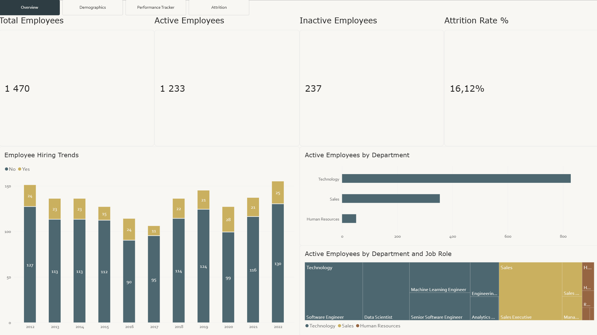
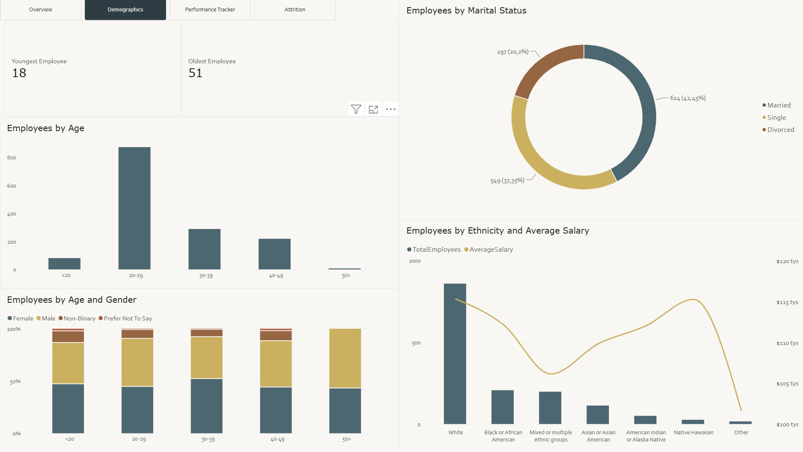
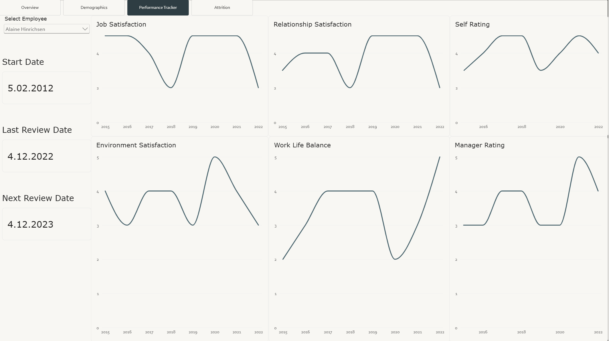
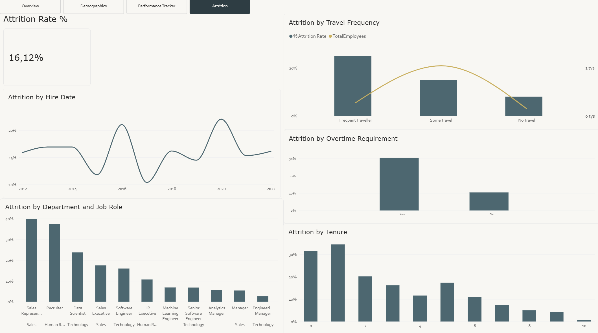

# HR Analytics Dashboard in Power BI

An end-to-end Power BI project analysing the workforce of a fictional company of **1,470 employees**: headcount, hiring trends, demographics, individual performance reviews and **employee attrition (16.1%)**.

The project covers the full workflow, not just the dashboard: loading raw CSV files, fixing data-type and locale issues in Power Query, building a star-schema data model with active and inactive relationships, writing DAX measures, and designing a 4-page interactive report.

> Based on the DataCamp case study *HR Analytics in Power BI*. I rebuilt the project locally on my own copy of the data and made several changes to the original solution. They are listed in [What I changed vs. the course solution](#what-i-changed-vs-the-course-solution).



---

## Business questions

1. How many employees does the company have, and how many have left?
2. How has hiring developed over time, and which hiring cohorts left most often?
3. What does the workforce look like in terms of age, gender, marital status, ethnicity and salary?
4. How has a selected employee's satisfaction and performance rating changed over the years, and when is their next review due?
5. Which factors are associated with higher attrition, such as overtime, business travel, tenure, department and job role?

---

## Tools

- **Power BI Desktop**: Power Query (M), data modelling, DAX, report design
- **Power BI Project format (`.pbip`)**: the model is saved as TMDL text files and the report as JSON, so every transformation and measure can be reviewed directly on GitHub

---

## Data

Six source files: two fact/dimension tables with employee data and three lookup tables.

| File | Table in model | Rows | Description |
|---|---|---|---|
| `Employee.csv` | `DimEmployee` | 1,470 | One row per employee: demographics, department, job role, salary, hire date, overtime, travel, tenure, attrition flag |
| `PerformanceRating.csv` | `FactPerformanceRating` | 6,709 | One row per annual review (2013–2022): satisfaction scores (1–5), self rating and manager rating (1–5), training |
| `EducationLevel.csv` | `DimEducationLevel` | 5 | Education code → label (e.g. 3 = Bachelors) |
| `RatingLevel.csv` | `DimRatingLevel` | 5 | Rating code → label (e.g. 4 = Exceeds Expectation) |
| `SatisfiedLevel.csv` | `DimSatisfiedLevel` | 5 | Satisfaction code → label (e.g. 1 = Very Dissatisfied) |
| `DimDate.txt` | `DimDate` | – | DAX script for a calculated date table |

1,280 of the 1,470 employees have at least one performance review. The remaining employees, mostly recent hires, have none. The report handles this case explicitly (see `LastReviewDate`).

---

## Process

### 1. Loading the data (Power Query)

- Loaded all five CSV files from a local folder (`Csv.Document` + `File.Contents`, UTF-8).
- Promoted the first row to headers and set an explicit data type for every column: text IDs, whole numbers for scores, ages, salary and tenure, and dates.
- Named the tables using a **Fact / Dim** convention (`FactPerformanceRating`, `DimEmployee`, …) to make the star schema obvious.

### 2. Fixing the date format (locale issue)

`ReviewDate` is stored in US format (`M/D/YYYY`, e.g. `3/16/2016`). With a Polish locale Power BI reads it as `D/M/YYYY`, which caused two problems:

- dates such as `3/16/2016` turned into **errors** (there is no 16th month);
- dates such as `1/2/2013` converted **silently but incorrectly**: 2 January became 1 February.

Removing the error rows would have dropped valid data and left the incorrect dates in place, so I fixed the conversion itself. I imported the column as text and converted it with **Change Type → Using Locale → English (United States)**:

```m
#"Changed Type with Locale" =
    Table.TransformColumnTypes(#"Changed Type", {{"ReviewDate", type date}}, "en-US")
```

The same locale-aware conversion is applied to `HireDate` in `DimEmployee`.

### 3. Feature engineering

**Age groups.** I added a conditional column `AgeBins` (`<20`, `20-29`, `30-39`, `40-49`, `50>`) in Power Query so age can be analysed as categories.

**Sort order for age groups.** Text values sort alphabetically, so `<20` ended up last on the chart. I added a numeric helper column `AgeBinsSorted` (1–5) and used it as the *Sort by column* for `AgeBins`:

```m
#"Added AgeBinsSorted" = Table.AddColumn(#"Added AgeBins", "AgeBinsSorted",
    each if [Age] >= 50 then 5 else if [Age] >= 40 then 4
    else if [Age] >= 30 then 3 else if [Age] >= 20 then 2 else 1),
#"Changed Type1" = Table.TransformColumnTypes(#"Added AgeBinsSorted", {{"AgeBinsSorted", Int64.Type}})
```

**Full name.** A DAX calculated column used by the employee slicer on the Performance page:

```dax
FullName = COMBINEVALUES(" ", DimEmployee[FirstName], DimEmployee[LastName])
```

### 4. Date table

`DimDate` is a calculated table built in DAX with `CALENDAR` + `ADDCOLUMNS`. It covers full years from the first to the last hire date and includes year, quarter, month, week and day attributes, start/end dates of each period, and fiscal year, quarter and month (fiscal year starting in April):

```dax
VAR _minYear = YEAR ( MIN ( DimEmployee[HireDate] ) )
VAR _maxYear = YEAR ( MAX ( DimEmployee[HireDate] ) )
VAR _fiscalStart = 4
RETURN
ADDCOLUMNS (
    CALENDAR ( DATE ( _minYear, 1, 1 ), DATE ( _maxYear, 12, 31 ) ),
    "Year", YEAR ( [Date] ),
    "MonthName", FORMAT ( [Date], "MMMM" ),
    "YearQuarterName", FORMAT ( [Date], "YYYY" ) & " Q" & FORMAT ( [Date], "Q" ),
    ...
)
```

### 5. Data model

A star schema with `FactPerformanceRating` in the centre:

```
                DimDate
                   │ Date ── ReviewDate (active)
                   │ Date ── HireDate   (inactive)
DimEmployee ── FactPerformanceRating ── DimSatisfiedLevel
     │          EmployeeID   (M:1)       (Environment ✔, Job / Relationship / WorkLifeBalance ✖)
     │                        └──────── DimRatingLevel
DimEducationLevel                       (SelfRating ✔, ManagerRating ✖)
                                                        ✔ active   ✖ inactive
```

Several columns point to the **same lookup table**: four satisfaction scores point to `DimSatisfiedLevel`, and two ratings point to `DimRatingLevel`. A pair of tables can have only one active relationship in Power BI, so the remaining relationships are **inactive** and are switched on inside measures with `USERELATIONSHIP`. The same approach lets me analyse employees by **hire date** even though the active date relationship uses **review date**.

### 6. DAX measures

All measures are kept in a dedicated `_Measures` table.

**Headcount and attrition**

```dax
TotalEmployees    = DISTINCTCOUNT ( DimEmployee[EmployeeID] )
ActiveEmployees   = CALCULATE ( [TotalEmployees], FILTER ( DimEmployee, DimEmployee[Attrition] = "No" ) )
InactiveEmployees = CALCULATE ( [TotalEmployees], FILTER ( DimEmployee, DimEmployee[Attrition] = "Yes" ) )
% Attrition Rate  = DIVIDE ( [InactiveEmployees], [TotalEmployees] )
AverageSalary     = AVERAGE ( DimEmployee[Salary] )
```

**Time-based analysis using the inactive hire-date relationship**

```dax
TotalEmployeesDate =
    CALCULATE ( [TotalEmployees], USERELATIONSHIP ( DimEmployee[HireDate], DimDate[Date] ) )

InactiveEmployeesDate =
    CALCULATE ( [InactiveEmployees], USERELATIONSHIP ( DimEmployee[HireDate], DimDate[Date] ) )

% Attrition Rate Date = DIVIDE ( [InactiveEmployeesDate], [TotalEmployeesDate] )
```

**Performance tracker (per employee)**

```dax
EnvironmentSatisfaction =
    CALCULATE (
        MAX ( FactPerformanceRating[EnvironmentSatisfaction] ),
        USERELATIONSHIP ( FactPerformanceRating[EnvironmentSatisfaction], DimSatisfiedLevel[SatisfactionID] )
    )
-- same pattern for JobSatisfaction, RelationshipSatisfaction, WorkLifeBalance,
-- SelfRating and ManagerRating

LastReviewDate =
    VAR LastReview = MAX ( FactPerformanceRating[ReviewDate] )
    RETURN
        IF ( ISBLANK ( LastReview ), "No Review Yet", FORMAT ( LastReview, "d.MM.yyyy" ) )

NextReviewDate =
    VAR reviewOrHire =
        IF (
            MAX ( FactPerformanceRating[ReviewDate] ) = BLANK (),
            MAX ( DimEmployee[HireDate] ),
            MAX ( FactPerformanceRating[ReviewDate] )
        )
    RETURN reviewOrHire + 365
```

`NextReviewDate` assumes an annual review cycle: one year after the last review, or one year after hiring if the employee has not been reviewed yet.

---

## Report

The report has four pages, with a page navigator for moving between them.

### Overview
KPI cards (total, active and inactive employees, attrition rate); **hiring trends** by hire date split by attrition status; active employees **by department**; treemap of active employees **by department and job role**.


### Demographics
Oldest and youngest employee; employees **by age group** and **by age group and gender** (100% stacked); **marital status** (donut); headcount and **average salary by ethnicity** (combo chart). The page has a filter on attrition status.



### Performance Tracker
An employee slicer drives the page: start date, last and next review date, and six line charts showing how the employee's **job, environment and relationship satisfaction, work-life balance, self rating and manager rating** changed year by year.



### Attrition
Overall attrition rate plus attrition **by hire date**, **department and job role**, **business travel frequency** (with headcount on a secondary axis), **overtime** and **tenure** (years at company).



---

## Key insights

- **Overall attrition is 16.1%**: 237 of 1,470 employees have left the company.
- **Overtime is the strongest signal.** Employees who work overtime leave at **30.5%**, about three times the rate of those who don't (**10.4%**).
- **Attrition rises with business travel:** **8.0%** for employees who don't travel, **15.0%** for some travel and **24.9%** for frequent travellers.
- **Most leavers are new hires.** Attrition is **31.6%** among employees with less than a year at the company and **34.5%** among those with one year, then falls to **15.1%** at 3–5 years and **5.5%** at 6–10 years.
- **Sales has the highest attrition by department (20.6%)**, ahead of Human Resources (19.0%) and Technology (13.8%). By job role the highest rates are **Sales Representatives (39.8%)** and **Recruiters (37.5%)**. Management roles stay below 6%.
- **Younger employees leave more often:** **20.9%** in the 20–29 group compared with **9.3%** at 30–39 and **6.8%** at 40–49.

*These figures show associations in the data, not causes. For example, younger employees also tend to have shorter tenure.*

---

## What I changed vs. the course solution

- **Local data source:** loaded the CSVs from local files instead of the course's web URLs.
- **Correct date parsing:** the course solution converts `ReviewDate` with the default locale. On a Polish-locale machine this produced errors and silently swapped day and month. I fixed it with a locale-aware type conversion (`en-US`).
- **Age-group sort order:** added the `AgeBinsSorted` helper column so age groups appear in logical order instead of alphabetical order.
- **`LastReviewDate`:** refactored the measure with a variable (`VAR`) so the `MAX` is evaluated once, and replaced the `= BLANK()` comparison with `ISBLANK()`. Because the measure returns either text or a date, the date is formatted with `FORMAT` so both cases display consistently.
- **Consistent formatting:** KPI cards show exact values (`1 470` instead of the auto-abbreviated `1,47K`) using text measures such as `TotalEmployees Label = FORMAT([TotalEmployees], "#,0")`, and all date cards on the Performance Tracker page use one date format.

---

## How to open the project

1. Clone the repository.
2. Download the source CSV files from the DataCamp case study *HR Analytics in Power BI*.
3. Open `HR Analytics.pbip` in Power BI Desktop.
4. Point each query to the folder where you saved the CSV files (**Transform data → Data source settings → Change source**), then click **Refresh**.

The data source paths in the queries point to my local machine, so step 4 is needed before the data can be refreshed. All Power Query steps, DAX measures and relationships can be read directly in the `HR Analytics.SemanticModel/definition/` folder without opening Power BI.

## Repository structure

```
├── HR Analytics.pbip               # entry point – open this in Power BI Desktop
├── HR Analytics.SemanticModel/     # data model as TMDL: tables, Power Query, DAX, relationships
│   └── definition/tables/          #   one file per table, e.g. _Measures.tmdl, DimEmployee.tmdl
├── HR Analytics.Report/            # report pages and visuals as JSON
└── images/                         # report screenshots
```
